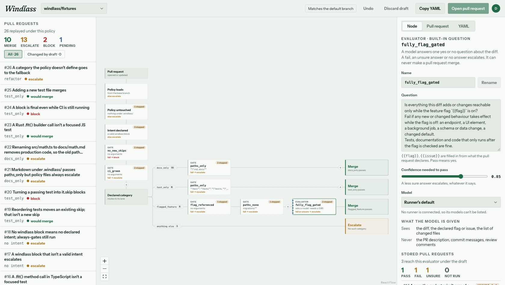

# Windlass

A policy engine that decides, for each agent-authored pull request, whether to **merge**, **escalate** to a human, or **block**. It combines deterministic gates with narrowly scoped LLM evaluators and fails closed. See [`docs/brief.md`](docs/brief.md) for the design.

This is phase 1 of the brief, in shadow mode: nothing is merged, and no LLM calls are made yet.

- The **engine library** (`src/`): policy parser and validator, diff fact collector, the `paths_only`, `ci_green` and `no_new_skips` gates, the graph walker, the decision record and a fixture harness.
- A **GitHub App** (`app/`, `web/`): judges PRs as webhooks arrive, keeps what it saw, and serves a flowchart editor that replays those PRs under a draft policy. See [The App and the editor](#the-app-and-the-editor).
- A **GitHub Action** (`action/`): the same judging with nothing to host, and no editor.

## How a PR is decided

A policy lives in `.windlass/policy.yaml` (see [`examples/policy.yaml`](examples/policy.yaml)). The PR declares its intent in a fenced block in its body:

````markdown
```windlass
category: docs_only
```
````

`decide` walks the PR through:

1. **Policy.** If it's invalid, escalate.
2. **Protected paths.** If the PR changes anything under `.windlass/`, escalate.
3. **Intent.** If the `windlass` block is missing or malformed, escalate (the always-gates still run and are recorded).
4. **Always-gates**, from `defaults.always`.
5. **Category.** If the declared category isn't in the policy, apply `fallback`. Otherwise run its gates.
6. **Evaluators**, but only if nothing has pushed the PR off the merge path. Errors, timeouts, malformed output and low confidence all escalate.
7. The category's **outcome**.

Every node contributes an outcome, and the most severe one wins: `block` > `pending` > `escalate` > `merge`. `pending` means CI is still running, so the adapter should wait for the next event instead of acting.

| Gate                                     | Passes when                                                                                                                                      | Fails →  |
| ---------------------------------------- | ------------------------------------------------------------------------------------------------------------------------------------------------ | -------- |
| `paths_only: [globs]`                    | every changed path, including the old side of renames, matches a glob                                                                            | escalate |
| `ci_green` (`required`, `ignore`)        | every check (or every required check) passed; pending while any are running                                                                      | escalate |
| `no_new_skips` (`extra`, `ignore_paths`) | no added test skip/focus or lint/type/coverage suppression in code files, each language's markers only in its own files; moved lines don't count | block    |

Any gate takes `on_fail: escalate | block` to override its default.

## Usage

```ts
import { decide } from "@pluscosmic/windlass";

const decision = await decide(
  { baseSha, headSha, body: prBody, diff: unifiedDiff, ci: { checks } },
  { policy: policySourceFromBaseBranch },
);
decision.outcome; // "merge" | "escalate" | "block" | "pending"
```

The `DecisionRecord` contains the path taken, every gate result with evidence, every evaluator verdict and model, the policy hash and version, both SHAs and the engine version.

## GitHub Action (shadow mode)

Copy [`examples/policy.yaml`](examples/policy.yaml) to `.windlass/policy.yaml` and [`examples/windlass.yml`](examples/windlass.yml) to `.github/workflows/windlass.yml` in the repo to judge, and set `workflow_run.workflows` to that repo's CI workflow names.

On each PR event, and again when CI finishes, the Action:

1. reads the policy from the PR's **base** branch through the API (it never checks out PR code),
2. fetches the PR's diff, its check runs and commit statuses (ignoring its own job), and the `windlass` block,
3. runs `decide`,
4. posts or updates a single comment with the outcome, reasons, gate results and the full decision record, and sets one of the `windlass/would-merge`, `windlass/escalate` or `windlass/block` labels.

It never merges. While CI is still running the decision is `pending`: nothing new is posted, outcome labels are cleared, and an earlier comment for an older head is marked as out of date. Each decision is also written to `decision-<number>.json` in the `decision-dir` output (the example workflow uploads it as an artifact) and to the job summary.

| Input            | Default                 |                                                                                                   |
| ---------------- | ----------------------- | ------------------------------------------------------------------------------------------------- |
| `github-token`   | `github.token`          | needs `contents: read`, `pull-requests: write`, `issues: write`, `checks: read`, `statuses: read` |
| `policy-path`    | `.windlass/policy.yaml` | read from the base branch                                                                         |
| `mode`           | `shadow`                | the only mode in v1                                                                               |
| `ignore-checks`  |                         | extra check names not to count as CI                                                              |
| `comment-author` | `github-actions[bot]`   | only this user's Windlass comments are updated                                                    |
| `pull-request`   |                         | PR number, for `workflow_dispatch` runs                                                           |

The Action runs from the committed bundle in `action/dist/`; `bun run build:action` regenerates it and CI fails if it's out of date.

## The App and the editor

The App does what the Action does (the comment and the label), reports a `Windlass` check run, and remembers each PR it judges: its diff, CI checks and `windlass` block. Being an App, it is told when CI finishes instead of needing a `workflow_run` trigger, and the workflow that judges a PR is no longer a file the PR can edit.

The editor draws the policy as the flowchart `decide` walks: the built-in checks and always-gates down the left, then one lane per category. On it you can:

- click a pull request to watch it travel the policy, with each node's result and evidence;
- add, change, move and remove gates, add categories (it lists the ones PRs declared that the policy lacks), and set outcomes;
- add an evaluator to a lane, write its question, and run it over the remembered PRs to see what a model answers before the policy depends on it;
- see, as you edit, how every remembered PR would be decided under the draft against the policy on the default branch;
- edit the YAML directly; edits on the canvas keep the file's comments.

Saving opens a pull request with the new policy. It is never written to the default branch, and since the PR touches `.windlass/`, Windlass escalates it to a human.

### Evaluators

An evaluator puts one yes-or-no question about the diff to a model, and its lane merges only on a confident yes:

```yaml
flagged_feature:
  gates:
    - flag_referenced # the declared flag appears in a line the PR adds
    - paths_none: ["migrations/**"]
  evaluators:
    - id: fully_flag_gated
      question: |
        Is everything this diff adds or changes reachable only while the feature flag `{{flag}}` is on?
      min_confidence: 0.85
  outcome: merge
```

`{{flag}}` and `{{issue}}` come from the PR's `windlass` block. `fully_flag_gated` has a built-in question, so `question` can be left out. A fail, an answer below `min_confidence`, an error or no answer all escalate, and a verdict has to cite files the diff changes.



Windlass doesn't call the model itself. A **runner**, a second container from the same image, pulls questions from the App and answers them with a credential only it holds: a Claude subscription token or an API key. The model gets the diff, the list of changed files and the question, with every tool off.

[`docs/deploy.md`](docs/deploy.md) covers registering the App, its configuration, deploying it and running it locally.

## Fixtures

Each directory in `test/fixtures/` is a sample PR: `case.yaml` (body, CI checks, expected outcome) and `diff.patch`. They run as part of `bun run test`, and `@pluscosmic/windlass/harness` exposes `runFixture` for running them elsewhere.

## Development

```sh
bun install
bun run check   # typecheck, lint, test, the builds, format:check
```
